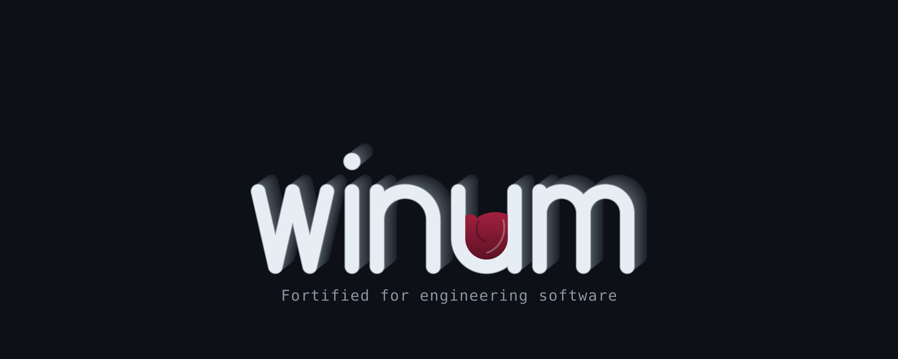

  

**winum** is a build of [Wine](https://www.winehq.org/) with fixes for
engineering software: CAD, CAE and the installers and add-ins around them.
It is vanilla Wine plus a small, documented set of patches, built in public
and published as versioned releases.

*Winum* is how the Romans pronounced *vinum*, wine.

> **Status (25 November 2026).** Current release:
> [`winum-11.22-3`](docs/release/winum-11.22-3.md) - Wine 11.22 with 80
> patches: the 73 of [`winum-11.22-2`](docs/release/winum-11.22-2.md)
> plus six fixes that make Autodesk Inventor Nastran 2027 work (token
> integrity level in wineserver and ntdll, per-user COM classes in
> combase, HKCR reads in kernelbase, WMI method calls in wbemdisp,
> ADODB.Stream text in msado15) and ClearType font smoothing in win32u
> (diagnosed by @krokosik). Validation: L0 both architectures with
> `--fuzz=0`; L1 and L2 per patch and for all seven together; L4 in
> Inventor 2027 (with Nastran) and AutoCAD 2027; SOLIDWORKS L4 deferred.
> Every patch in `patches/series` has a Wine test that passed on Windows
> 10 (L1) or a recorded reason why not; `scripts/check-series.sh` checks
> it. Next: Wine 11.23.

## Releases

| Release | Wine | Date | Patches | What it added |
| --- | --- | --- | --- | --- |
| [winum-11.22-3](docs/release/winum-11.22-3.md) | 11.22 | 2026-11-25 | 80 | Inventor Nastran 2027 (token integrity, per-user COM classes, HKCR reads, WMI methods, ADODB.Stream text), ClearType font smoothing (@krokosik) |
| [winum-11.22-2](docs/release/winum-11.22-2.md) | 11.22 | 2026-11-23 | 73 | Inventor's Open/Save dialogs (shell32), msxml3 same node (@Lukas10999), AutoCAD Save As crash (ucrtbase) and "Connection Lost" (wineserver) |
| [winum-11.22-1](docs/release/winum-11.22-1.md) | 11.22 | 2026-11-16 | 66 | the 66 patches moved to Wine 11.22 |
| [winum-11.20-2](docs/release/winum-11.20-2.md) | 11.20 | 2026-11-12 | 66 | Import CAD Reference Model (ole32, packager), contributed by @krokosik |
| [winum-11.20-1](docs/release/winum-11.20-1.md) | 11.20 | 2026-11-11 | 62 | the first winum: the Inventor project's series, SOLIDWORKS and MSI fixes |

Every patch of the current series, with the release it came in and the
validation it reached (L0-L5, cross review), is listed in
[docs/patches/README.md](docs/patches/README.md); each has its own page
next to it.

## Who uses it

- [Autodesk Inventor on Linux](https://github.com/Harvi654/Autodesk-Inventor-for-Linux) (2026, 2027)
- Autodesk AutoCAD (2027) (not public yet, currently in development, public release planned)
- Autodesk Revit (2027) (not public yet, currently in development, public release planned)
- SOLIDWORKS 2026 on Linux (not public yet, currently in development, public release planned)

The projects download a pinned winum release and check its SHA-256. One
Wine for all of them: a patch that changes a DLL several of them use is
tested in each before it is released (or its test there is recorded as
deferred, see AGENTS.md).

winum is not affiliated with WineHQ, Autodesk or Dassault Systèmes. Wine is
a trademark of the Wine project; Autodesk, Inventor and SOLIDWORKS are
trademarks of their owners and are named here only to say what the build
was tested with. No program of theirs is part of this repository.

## What is in a release

- vanilla Wine `WINE_VERSION` (see `wine/version.env`) with the patches in
  `patches/series`, applied in that order;
- the complete source of exactly that build (`winum-<version>-<build>-source.tar.xz`);
- SHA-256 sums.

Release names are `winum-<Wine version>-<build>`, for example
`winum-11.20-1`. The build number goes up whenever the patches change; a
published release is never replaced.

Every push to `main` builds the series in public (GitHub Actions, "Build
Wine") as a check. A release is made only when the maintainer pushes a
signed tag `winum-<version>-<build>` that matches `wine/version.env`; the
workflow then builds from the tag and publishes the binary, the source and
a signed provenance attestation. To build it yourself:
`bash scripts/build-wine.sh` (Wine's build dependencies and mingw-w64,
about 10 GB and 1-2 hours).

## How a patch gets in

Every patch:

1. fixes one problem a real program shows, in one DLL, in the style of
   the surrounding Wine code;
2. comes with a test in Wine's own test suite that fails on vanilla Wine
   and passes with the patch, and whose expected values were measured on
   real Windows;
3. is reviewed by a second reviewer before it goes into `patches/series`;
4. has a short plain-language write-up in `docs/patches/`, with the
   validation level it reached (L0 build … L5 a week of real use); the
   overview of all of them is [docs/patches/README.md](docs/patches/README.md).

Rules for contributors and AI assistants are in [AGENTS.md](AGENTS.md).

## About AI

Most patches here are written with AI assistance (Claude, Codex) and are
marked so. Wine does not accept AI-generated code, so these patches are
**not** sent to Wine. What goes to Wine is bug reports written in words,
with a public test anyone can run.

## License

The patches change Wine, which is LGPL, so they are
**LGPL-2.1-or-later** ([LICENSE](LICENSE)), as is everything else in this
repository unless a file says otherwise. The logo uses outlines of the
fonts Fraunces and IBM Plex Mono (SIL Open Font License 1.1), see
[docs/brand](docs/brand/README.md).
