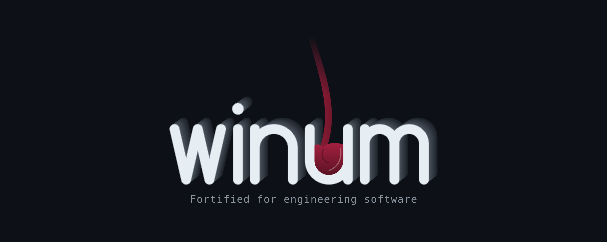

  

**winum** is a build of [Wine](https://www.winehq.org/) with fixes for
engineering software: CAD, CAE and the installers and add-ins around them.
It is vanilla Wine plus a small, documented set of patches, built in public
and published as versioned releases.

*Winum* is how the Romans pronounced *vinum*, wine.

> **Status: being set up (November 2026).** The patches still live in the
> projects that use them. They move here one by one, each with its test and
> its write-up; the first release will be `winum-11.20-1`.

## Who uses it

- [Autodesk Inventor on Linux](https://github.com/Harvi654/Autodesk-Inventor-for-Linux)
- SOLIDWORKS on Linux (not public yet)

Both projects download a pinned winum release and check its SHA-256. One
Wine for both programs: a patch that changes a DLL both of them use is
tested in both before it is released.

winum is not affiliated with WineHQ, Autodesk or Dassault Systèmes. Wine is
a trademark of the Wine project; Autodesk, Inventor and SOLIDWORKS are
trademarks of their owners and are named here only to say what the build
was tested with. No program of theirs is part of this repository.

## What is in a release

- vanilla Wine `WINE_VERSION` (see `wine/version.env`) with the patches in
  `patches/series`, applied in that order;
- the complete source of exactly that build (`winum-<version>-<build>-source.tar.xz`);
- SHA-256 sums.

Release names are `winum-<Wine version>-<build>`, for example
`winum-11.20-1`. The build number goes up whenever the patches change; a
published release is never replaced.

## How a patch gets in

Every patch:

1. fixes one problem a real program shows, in one DLL, in the style of
   the surrounding Wine code;
2. comes with a test in Wine's own test suite that fails on vanilla Wine
   and passes with the patch, and whose expected values were measured on
   real Windows;
3. is reviewed by a second reviewer before it goes into `patches/series`;
4. has a short plain-language write-up in `docs/patches/`, with the
   validation level it reached (L0 build … L5 a week of real use).

Rules for contributors and AI assistants are in [AGENTS.md](AGENTS.md).

## About AI

Most patches here are written with AI assistance (Claude, Codex) and are
marked so. Wine does not accept AI-generated code, so these patches are
**not** sent to Wine. What goes to Wine is bug reports written in words,
with a public test anyone can run.

## License

The patches change Wine, which is LGPL, so they are
**LGPL-2.1-or-later** ([LICENSE](LICENSE)), as is everything else in this
repository unless a file says otherwise. The logo uses outlines of the
fonts Fraunces and IBM Plex Mono (SIL Open Font License 1.1), see
[docs/brand](docs/brand/README.md).
